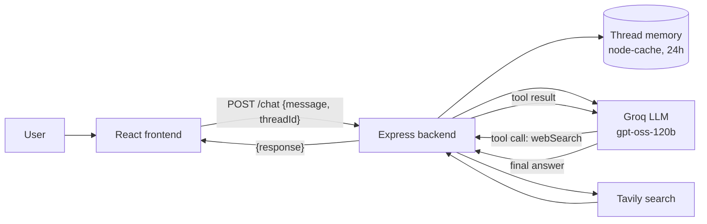

# ChatJPT

A full-stack AI chatbot named **Jarvis** that remembers your conversation and searches the web in real time whenever it needs fresh information.

The backend runs an LLM (`openai/gpt-oss-120b` on Groq) with a web-search tool (Tavily). The model decides for itself when to answer from its own knowledge and when to search. The frontend is a clean dark-mode chat UI built with React and TypeScript.


## Features

- **Real-time answers:** the model calls a `webSearch` tool for weather, news, current office holders and anything else that changes.
- **Conversation memory:** each chat has its own thread, so follow-up questions work.
- **Markdown replies:** lists, tables, code and links render properly (`react-markdown` + GitHub-flavoured Markdown).
- **Polished chat UX:** Enter to send, Shift+Enter for a new line, an animated "Thinking…" indicator, double-send protection and a friendly error message.
- **Safe key handling:** the Groq and Tavily keys live only on the server and never reach the browser.

## How it works



1. The frontend generates a unique `threadId` for the session and sends it with every message.
2. The backend loads that thread's history (or starts a new one with the system prompt) and appends the new message.
3. The model replies either with a final answer or with a request to call `webSearch`.
4. If it asks for a search, the backend runs it through Tavily, adds the results to the conversation and calls the model again. This repeats until the model answers, with a safety cap of 10 iterations.
5. The updated history is saved for the thread and the answer is returned to the UI.

## Tech stack

| Layer | Technologies |
| --- | --- |
| Frontend | React 19, TypeScript, Vite, Tailwind CSS v4, Axios, react-markdown, remark-gfm |
| Backend | Node.js, Express 5, groq-sdk, @tavily/core, node-cache, dotenv, cors, tsx |
| AI / Search | Groq (`openai/gpt-oss-120b`), Tavily Search API |

## Project structure

```
ChatJPT/
├── backend/
│   ├── server.js            # Express app: CORS, JSON, /health, mounts /chat
│   ├── routes/
│   │   └── chatRoute.js     # POST /chat: validates input, calls generate()
│   ├── assets/
│   │   └── chatbot.js       # LLM + tool-calling loop + thread memory
│   ├── app.js               # Original terminal (CLI) prototype
│   └── package.json
└── frontend/
    ├── src/
    │   ├── main.tsx         # React entry point
    │   ├── App.tsx          # Root layout
    │   └── components/
    │       └── Body.tsx     # Chat UI and API call
    ├── index.html
    └── package.json
```

## Getting started

### Prerequisites

- A recent version of [Node.js](https://nodejs.org/) (v20.19+ recommended) and npm
- A [Groq API key](https://console.groq.com/)
- A [Tavily API key](https://tavily.com/)

### 1. Clone the repository

```bash
git clone https://github.com/premrahi/ChatJPT.git
cd ChatJPT
```

### 2. Start the backend

```bash
cd backend
npm install
```

Create a `.env` file inside `backend/`:

```env
GROQ_API_KEY=your_groq_api_key
TAVILY_API_KEY=your_tavily_api_key
```

Then run it:

```bash
npm run dev
```

The API is now available at `http://localhost:4000`. You can check it with `http://localhost:4000/health`.

### 3. Start the frontend

In a second terminal:

```bash
cd frontend
npm install
npm run dev
```

Open the URL Vite prints (usually `http://localhost:5173`) and start chatting.

> The frontend currently calls `http://localhost:4000/chat`, so keep the backend on port 4000.

## API at a glance

| Method | Endpoint | Description |
| --- | --- | --- |
| `GET` | `/health` | Health check |
| `POST` | `/chat` | Send a message to a conversation thread |

```json
// POST /chat  (request)
{ "message": "Who is the current Prime Minister of India?", "threadId": "any-unique-id" }

// 200 response
{ "success": "ok", "response": "..." }
```

See [`backend/README.md`](./backend/README.md) for full details.

## Design decisions

- **Let the model decide when to search.** A single `webSearch` tool with `tool_choice: "auto"` avoids hard-coded rules about what counts as "real-time".
- **Teach the decision through the prompt.** The system prompt includes short examples of when to answer directly and when to search, and it injects the current date and time so "right now" questions make sense.
- **Deterministic output.** Temperature is set to 0 for consistent behaviour.
- **Bounded agent loop.** The tool-calling loop stops after 10 iterations and returns a fallback message instead of running forever.
- **Thread-scoped memory.** The full message history, including tool calls and results, is cached per `threadId` so the model keeps its context.

## Known limitations and next steps

- **Memory is in-process.** History is lost on restart and isn't shared between server instances. Moving it to Redis or a database is the natural next step.
- **History keeps growing.** Raw search results stay in the thread forever, which increases token usage over time. Trimming or summarising old tool output would help.
- **No streaming.** Replies appear all at once. Streaming tokens to the UI would make it feel faster.
- **Not deployment-ready yet.** The frontend hardcodes the API URL, and the backend is started with `tsx` because of extensionless imports. Moving the URL to an environment variable and adding a proper build or start step are the main tasks.
- **No auth or rate limiting** on the API.

## Author

Built by **Prem Rahi**. GitHub: [@premrahi](https://github.com/premrahi)